

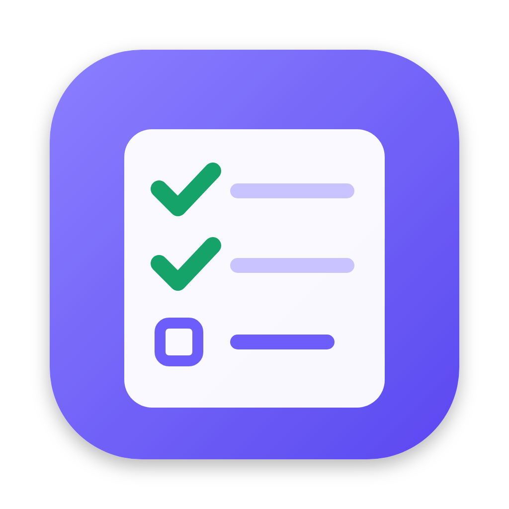

# Planer

**Планер дня с голосовым вводом: составили план, надиктовали задачи — вечером видно, что из плана
сделано, а что пришлось делать вне его.**

Работает на вашем компьютере (macOS, Windows). Голос распознаётся локально,
ИИ-помощник — по желанию, локально или через облачный сервис.

[**Скачать**](https://github.com/k1r14-py/Planer/releases/latest) ·
[Что нового](CHANGELOG.md) ·
[Планы](ROADMAP.md) ·
[Для разработчиков](docs/DEVELOPMENT.md)

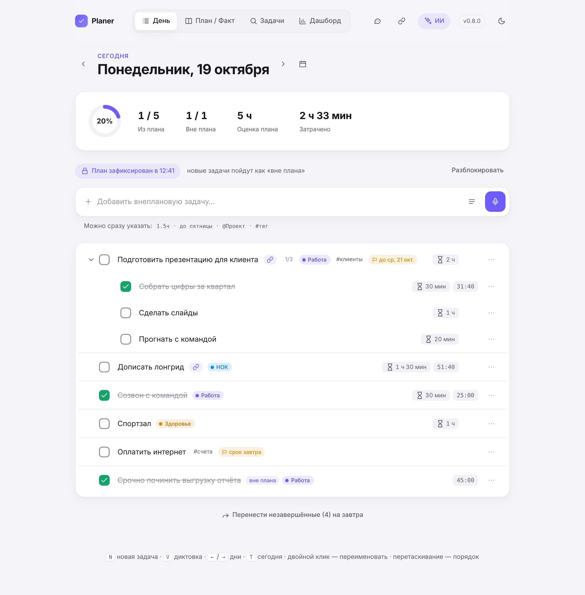

## Скачать

Откройте [последний релиз](https://github.com/k1r14-py/Planer/releases/latest) и скачайте файл
для своего компьютера:

| Компьютер | Файл |
|---|---|
| Mac с процессором Apple (M1, M2, M3, M4…) | `Planer-…-mac-arm64.dmg` |
| Mac с процессором Intel | `Planer-…-mac-x64.dmg` |
| Windows 10/11 | `Planer-…-win-x64.exe` |

**Mac:** откройте `.dmg` и перетащите Planer в «Программы». При первом запуске macOS предупредит
о неизвестном разработчике — откройте **Системные настройки → Конфиденциальность и безопасность** и
нажмите **«Всё равно открыть»** (один раз).
**Windows:** запустите `.exe` — права администратора не нужны. Если появится «Windows защитила ваш
компьютер» — **«Подробнее» → «Выполнить в любом случае»**.

Подробная инструкция — в [docs/INSTALL.md](docs/INSTALL.md). Новые версии потом ставятся кнопкой
с номером версии в правом верхнем углу.

## Что умеет

### План и факт

Составьте список задач на день и нажмите **«Зафиксировать план»** — всё, что добавите после, будет
помечено как «вне плана». Вкладка **«План / Факт»** показывает рядом, что планировалось и что реально
сделано, с оценками и затраченным временем.

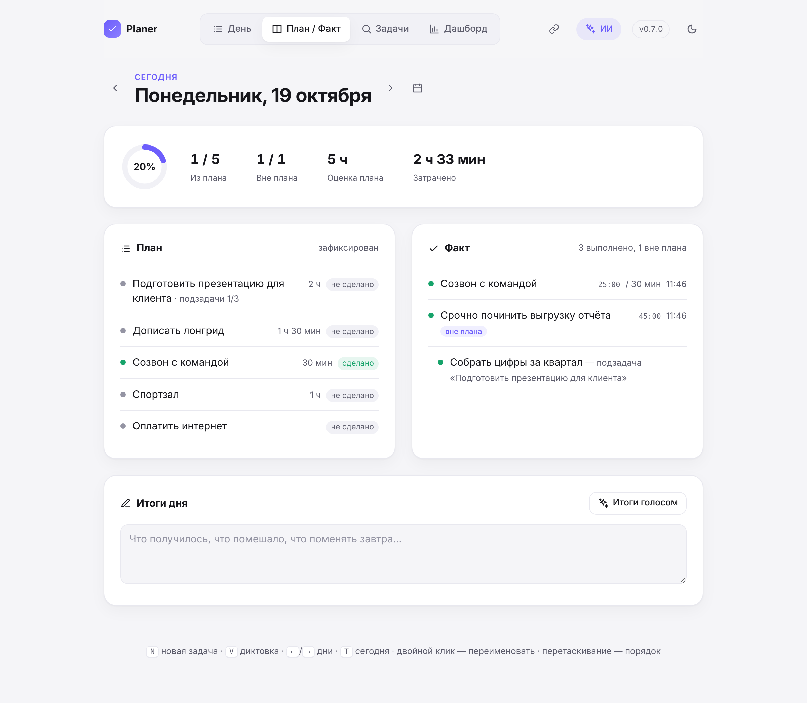

- Подзадачи: когда все сделаны, задача отмечается сама.
- Оценка времени и таймер ▶ у каждой задачи.
- Незавершённое переносится на завтра одной кнопкой.

### Голос и ИИ-помощник

Нажмите на микрофон (или **⌥⇧Пробел / Alt+Shift+Space** из любой программы) и надиктуйте план.
С ИИ можно говорить свободно — «надо бы к пятнице отчёт доделать, там сначала данные собрать,
и маме позвонить» превратится в задачи со сроками, подзадачами и оценками. Перед добавлением
список можно поправить.

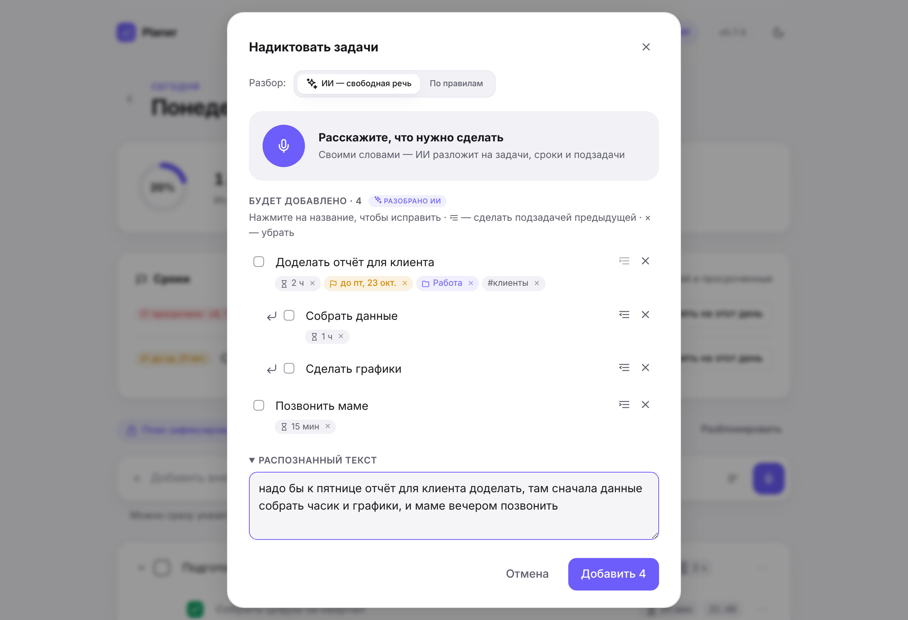

Вечером — **«Итоги голосом»**: расскажите, как прошёл день, и ИИ предложит, что отметить сделанным,
что перенести, какие внеплановые дела добавить, и напишет черновик итогов. Ничего не меняется без
вашего подтверждения.

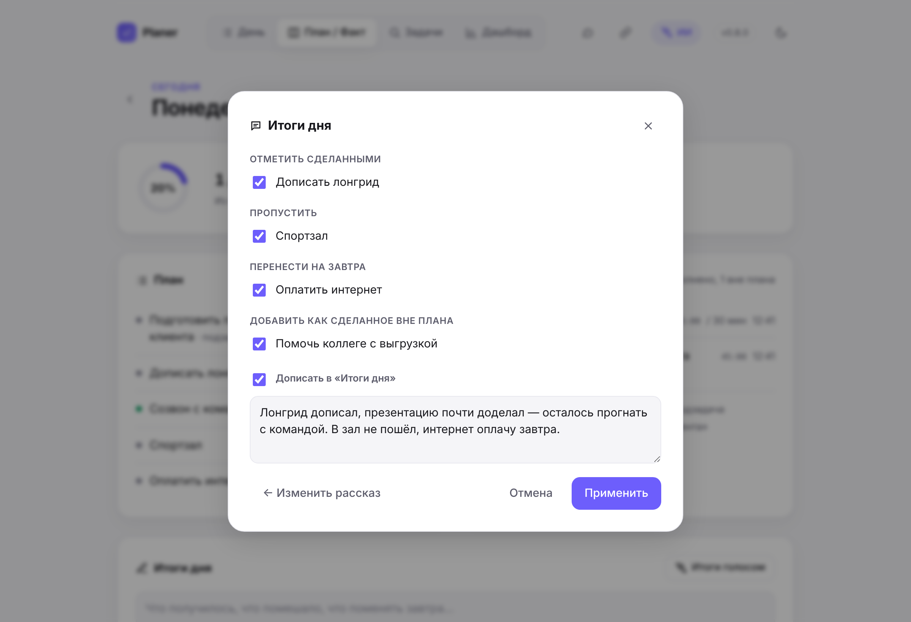

ИИ подключается в один клик: **на этом компьютере** (Planer сам установит Ollama и подберёт модель
под память компьютера — бесплатно, задачи никуда не уходят), **по подписке ChatGPT Plus/Pro** (вход
аккаунтом, без API-ключа), с бесплатным ключом **Gemini** или через **DeepSeek, Qwen, OpenAI API,
OpenRouter** и любой OpenAI-совместимый сервис. Без ИИ всё работает тоже — диктовка разбирается по
простым правилам (см. ниже).

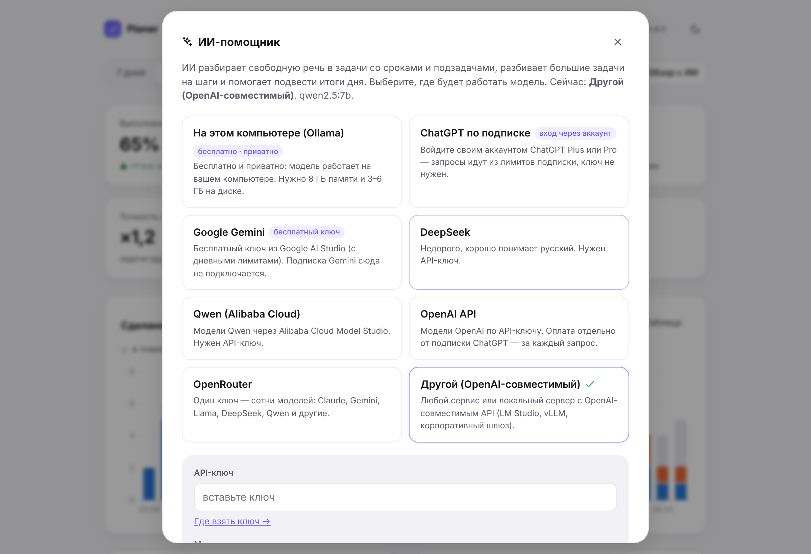

### Проекты, теги, сроки и поиск

Пишите прямо в строке ввода: `Отчёт 1.5ч до пятницы @Работа #срочно`. Задачи со сроком в ближайшую
неделю из других дней собираются в блок **«Сроки»** — просроченные видно сразу. На вкладке
**«Задачи»** — фильтры по проекту, тегу, периоду и статусу: например, «всё по проекту Работа за месяц».

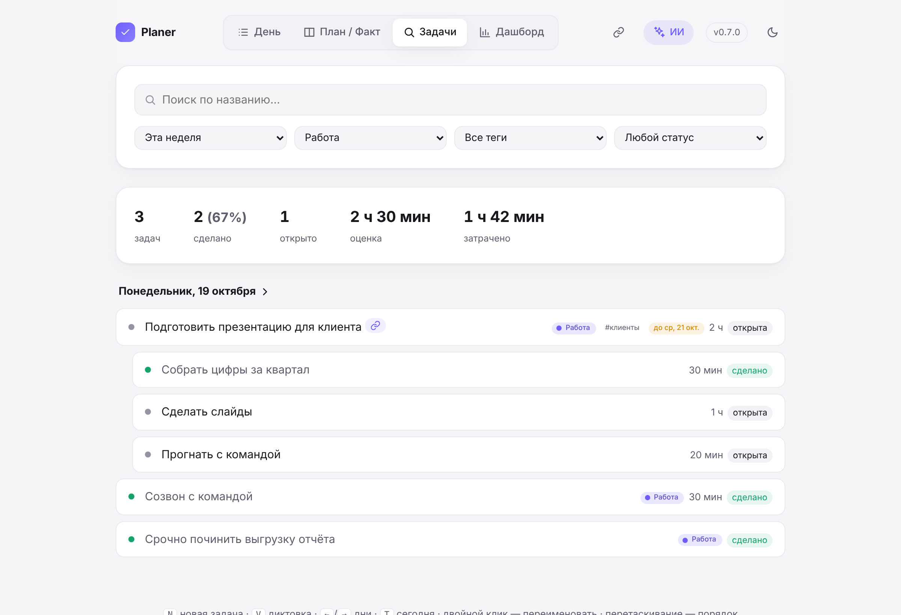

### Дашборд

Выполнение плана, сделанные задачи, время по таймеру, точность оценок и серия дней — со сравнением
с прошлым периодом. График по дням, тепловая карта активности, дни недели, проекты и теги.

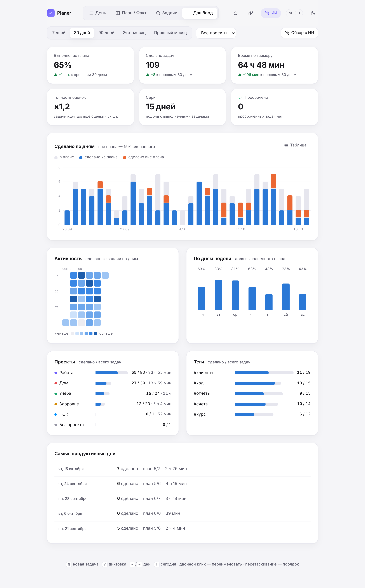

### Ссылки по ключевым словам

Задайте правило «нок + лонгрид → ссылка на задачу в Jira» — и у каждой задачи, где встречаются
эти слова, появится значок 🔗 с нужной ссылкой.

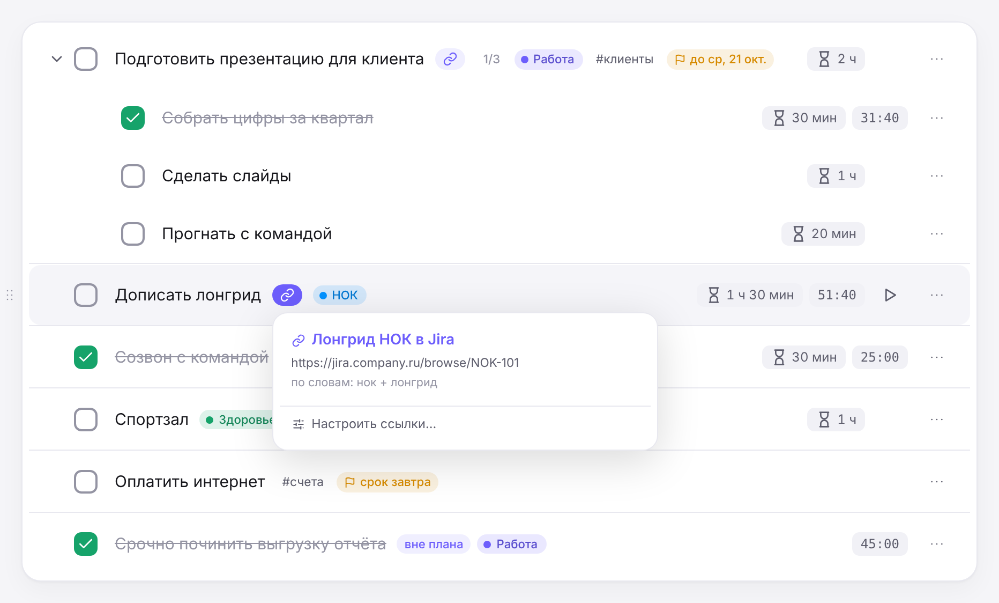

### И ещё

<table>
<tr>
<td width="62%">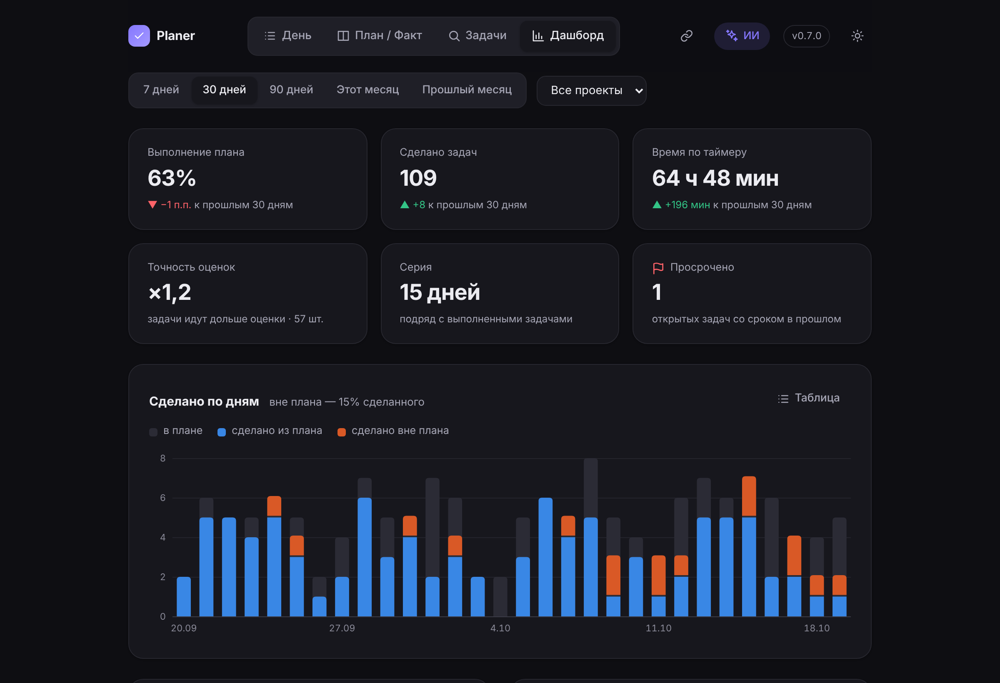</td>
<td>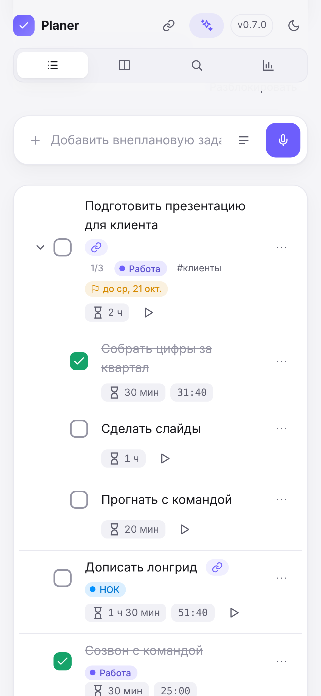</td>
</tr>
<tr>
<td>Тёмная тема</td>
<td>Интерфейс подстраивается под узкое окно</td>
</tr>
</table>

- Живёт в строке меню (Mac) или трее (Windows), может запускаться при входе в систему.
- Горячие клавиши: `N` — новая задача, `V` — диктовка, `←`/`→` — дни, `T` — сегодня.
- Обновление по кнопке: Planer сам скачает новую версию, сохранит копию задач и перезапустится.

## Как говорить без ИИ

| Говорите или пишите | Получается |
|---|---|
| точка, «потом», «затем», «дальше» | новая задача |
| «подзадача …», «подзадачи: а, б, в» | подзадачи к предыдущей задаче |
| «на 30 минут», «на час», «полтора часа» · в строке: `30м`, `1.5ч` | оценка времени |
| «до пятницы», «к 25 октября», «до конца недели», «дедлайн завтра» | срок |
| «…, проект Работа», «по проекту Работа» · в строке: `@Работа` | проект |
| «тег срочно» · в строке: `#срочно` | тег |

## Данные и приватность

- Задачи, настройки и ключи хранятся только на вашем компьютере
  (macOS: `~/Library/Application Support/Planer`, Windows: `%APPDATA%\Planer`). Перед каждым
  обновлением делается копия базы.
- Голос распознаётся локально (Whisper); при первом запуске один раз скачивается модель (~500 МБ).
- Текст задач уходит наружу, только если вы сами подключите облачный ИИ-сервис.
